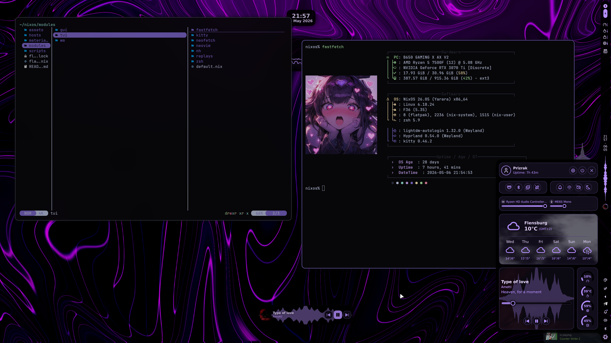
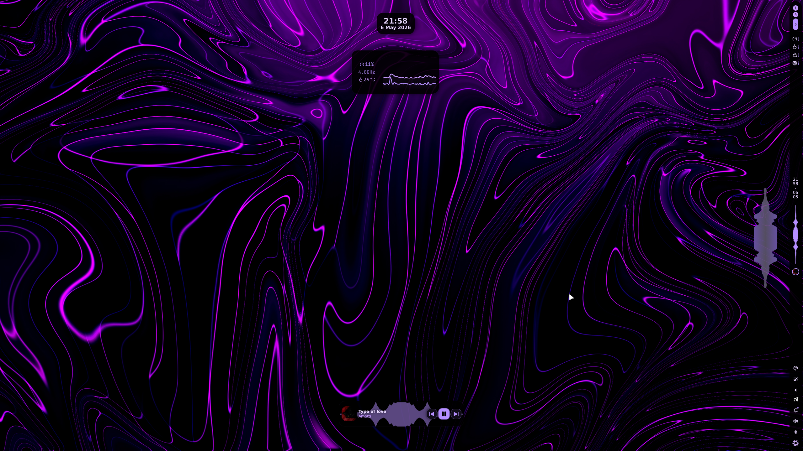

<div align="center">


</div>


### ABOUT

My personal NixOS setup, written as a flake.
The whole system (desktop, terminal, editor and tools) is described in code, so it can be rebuilt on any machine with one command.

| | |
|:--|:--|
| **OS** | NixOS (flakes) |
| **WM** | Hyprland |
| **Shell / bar** | Quickshell with [nothing-panel](https://github.com/yurei07/nothing-panel) (Nothing OS style) |
| **Terminal** | kitty |
| **Shell** | zsh |
| **Editor** | Neovim |
| **Media** | mpv |


### GALLERY

<p align="center">
  
  
</p>


### STRUCTURE

```text
.
├── flake.nix            # entry point
├── flake.lock           # pinned inputs
├── hosts/
│   └── Prizrak/         # machine config: configuration.nix, hardware, home, nix-modules
├── modules/
│   ├── gui/             # graphical apps (incl. Quickshell / Noctalia)
│   ├── tui/             # terminal: kitty, zsh and CLI tools
│   └── wm/              # Hyprland configuration
├── materials/           # wallpapers, theme, mpv config
├── scripts/             # helper scripts (e.g. nvim.sh)
└── assets/              # screenshots and README graphics
```

### INSTALLATION

> Review the config before using it. Replace the hardware configuration with your own.

```bash
git clone https://github.com/yurei07/nixos.git
cd nixos

# generate hardware config for your machine
sudo nixos-generate-config --show-hardware-config > hosts/Prizrak/hardware-configuration.nix

# build and switch
sudo nixos-rebuild switch --flake .#Prizrak
```

### CREDITS

- [Noctalia](https://github.com/noctalia-dev/noctalia) for the Quickshell setup
- [Hyprland](https://hyprland.org) and the NixOS community


