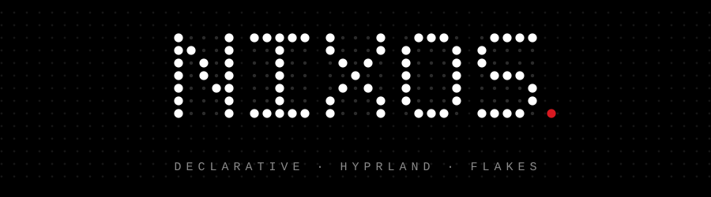
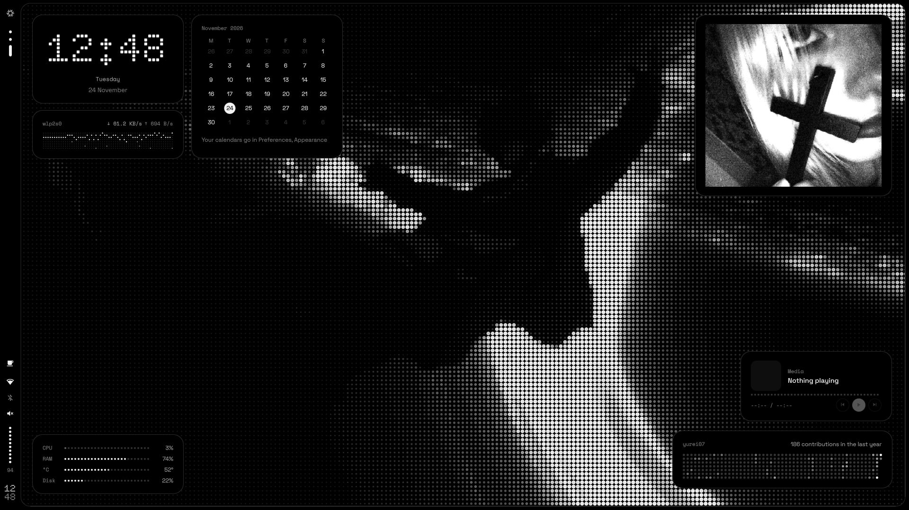

<div align="center">


</div>


### ABOUT

My personal NixOS setup, written as a flake.
The whole system (desktop, terminal, editor and tools) is described in code, so it can be rebuilt on any machine with one command.

| | |
|:--|:--|
| **OS** | NixOS (flakes) |
| **WM** | Hyprland (Lua config) |
| **Shell / bar** | [NIHIL](https://github.com/poligle/Nihil-Shell) on quickshell, vendored in-tree at `nihil/` |
| **Terminal** | kitty |
| **Shell** | zsh |
| **Editor** | Neovim |
| **Media** | mpv |


### GALLERY

<p align="center">
  
</p>


### STRUCTURE

```text
.
├── flake.nix                # entry point: NIHIL (vendored) + this machine's modules
├── flake.lock               # GitHub inputs only; nixpkgs pinned to the running system
├── hosts/
│   └── Prizrak/             # the machine's own configuration
│       ├── settings.json    # user, locale, keyboard, monitors, binds, gestures, programs
│       ├── hardware-configuration.nix
│       ├── local.nix        # machine-only services (docker, tailscale, openrgb, ...)
│       ├── home.nix         # user packages (telegram, steam, opencode, ...)
│       ├── modules/         # host-specific system modules (arduino, fonts, gpu, laptop, obs)
│       ├── user-modules/    # Home Manager modules (neovim, fastfetch)
│       ├── materials/mpv/   # mpv config and shaders
│       └── themes/kanso-zen.nix
├── nihil/                   # NIHIL itself, vendored via git subtree
│   ├── modules/             # system modules: settings, locale, binds, cli, ...
│   ├── home/                # Hyprland, the shell, zsh, sounds
│   ├── greeter/, installer/, wallpapers/, sounds/, docs/
│   └── ...
└── docs/                    # this README, LICENSE, assets
```


### REBUILDING

```bash
nihil rebuild          # build and switch (as sudo)
nihil check            # validate settings.json
nihil generations      # list generations, rollback with: nihil switch N
```

Everything machine-specific lives in `hosts/Prizrak/`: change `settings.json` (or the nix files), rebuild, done. The keys for NIHIL's actions are the machine's own, listed in `settings.json` under `binds`.

### UPDATING

```bash
cd /etc/nixos
nix flake update       # refresh GitHub inputs (nixpkgs, home-manager, stylix, ...)
git subtree pull --prefix nihil --squash https://github.com/poligle/Nihil-Shell nihil   # new NIHIL
nihil rebuild
```


### CREDITS

- [NIHIL](https://github.com/poligle/Nihil-Shell) by poligle — the desktop this machine runs
- [Hyprland](https://hyprland.org)
- NixOS and Home Manager communities


