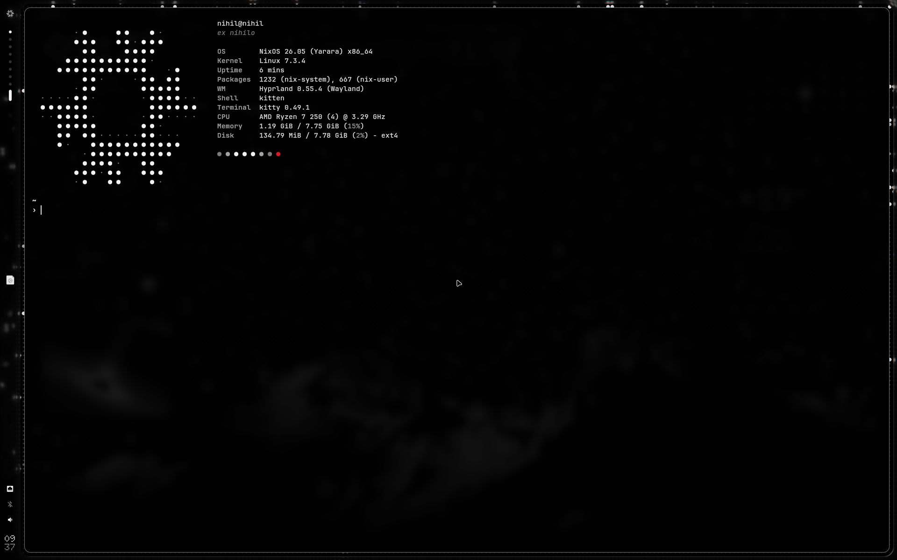
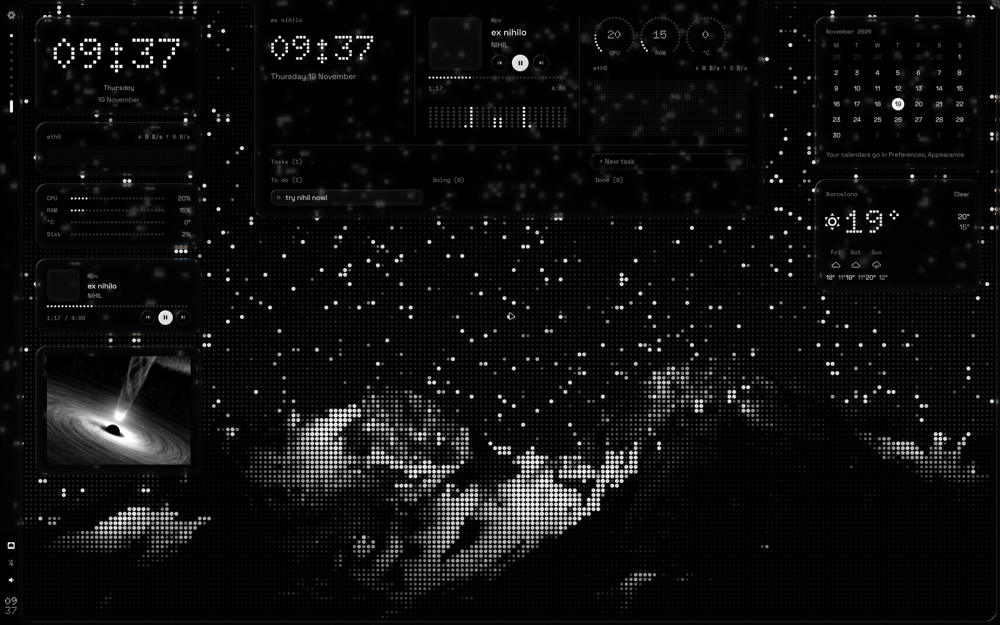
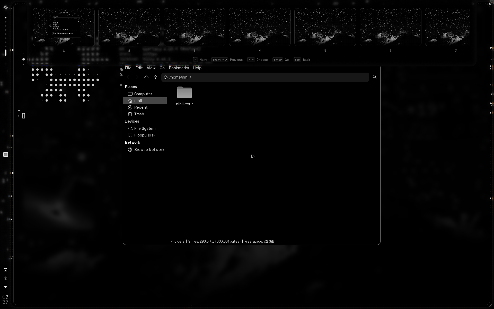
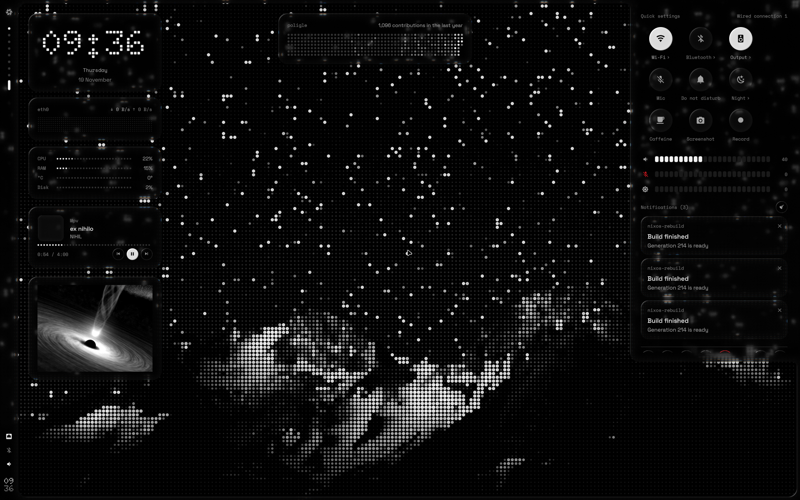
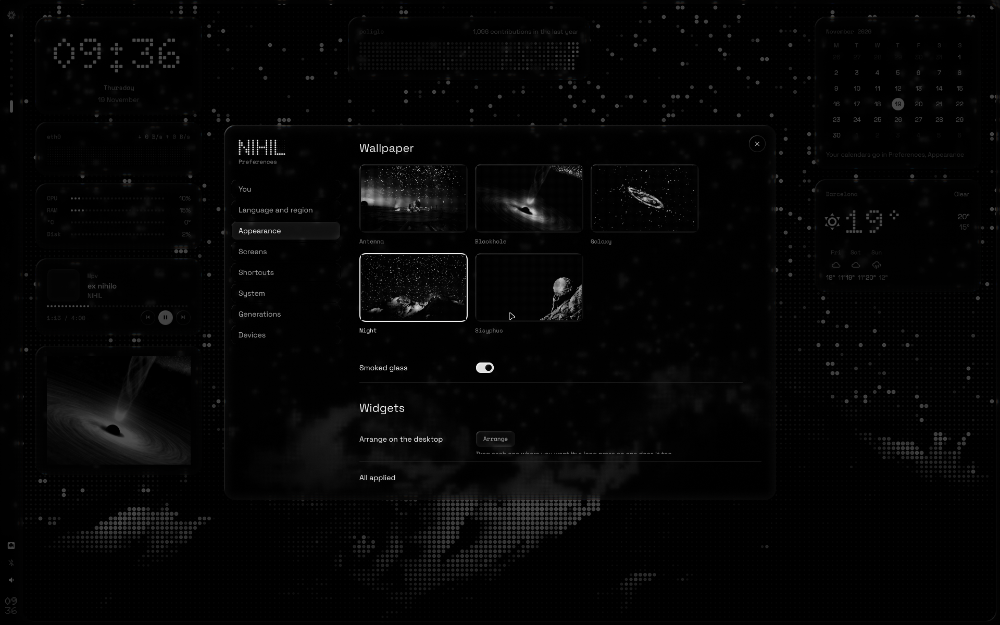

# Design

Three rules come before everything else:

1. **Hierarchy is made with greys.** Red is never decoration: it only interrupts — a
   failed login, a critical notification, the recording LED, a destructive action — and
   it is never small text: what went wrong is said in ink, with a red LED before it.
2. **Dots are for display.** Doto draws the clock and the big numbers; text stays in
   Space Grotesk, labels in Space Mono. All of it in sentence case: a capital to start,
   and proper names their own (no lowercase-only lines, no capitals-only ones).
3. **The frame is hardware.** Opaque, flat, no shadows; windows sit concentric with it.

| Token     | Hex       | Use                                   |
|-----------|-----------|---------------------------------------|
| `void`    | `#000000` | Frame, bar, drawers                   |
| `surface` | `#0E0E0E` | Cards inside drawers                  |
| `raised`  | `#1A1A1A` | Hover, slider tracks                  |
| `line`    | `#2A2A2A` | 1 px lines                            |
| `off`     | `#333333` | LEDs that are off                     |
| `muted`   | `#7A7A7A` | Metadata, inactive icons (4.89:1)     |
| `dim`     | `#A3A3A3` | Secondary text (8.33:1)               |
| `ink`     | `#F2F2F2` | Primary text, lit LEDs (18.76:1)      |
| `signal`  | `#D71921` | Interrupts only, never small text     |

Contrast ratios are against `#000000`. Fonts: [Doto](https://github.com/oliverlalan/Doto),
[Space Grotesk](https://github.com/floriankarsten/space-grotesk) and Space Mono (all SIL
OFL 1.1), plus JetBrains Mono Nerd Font for the terminal and glyphs. Icons: Colloid in
its grey variant; the shell shows app icons desaturated.

  

**Smoked glass**, off unless chosen in Preferences, Appearance: the frame, its drawers and every
card, key, tab, row and field in them, Preferences, the desktop's widgets, the lock
screen's field and the login's become dark glass. Behind it is what is really there: the
wallpaper (the output's own render, dot for dot) and, wherever glass can be over one, the
windows, captured live where they are (a drawer out, a notification, a window dragged
under the frame, Preferences). A third of it comes through the smoke. The bevel is clear
and bends it outwards, its colours a little apart where it bends most; the face beyond is
frosted and a little uneven, so the dots come through soft and their light spreads past
them, and the edge glows where something bright is near it; a glint where the light from
the top left catches the edge. Light surfaces (ink, red) frost more, so what is on them
keeps its contrast; the hairlines become the glass's own edges, and a border that says
something (focus, the one chosen, an error) stays. The shell draws it with two shaders
(`home/shell/shaders/`) over one texture of what is behind, with its mipmaps for the
frost (`components/Backdrop.qml`); hyprlock draws flat colours, so the lock screen's
glass is made into its background, once per wallpaper (`home/lock/glass.py`), twice in fact:
with the player's panel and without, and the lock shows one or the other as something plays
or stops. The terminal
goes with it: kitty's background lets a fifth through, which Hyprland blurs and darkens, and
the switch reaches the kitties already open (they read their configuration again).

| | |
|:---:|:---:|
|  |  |
| The dashboard: the time, what plays, the system and the tasks | Every workspace, with its windows <kbd>SUPER</kbd> <kbd>A</kbd> |
|  |  |
| Quick settings | Preferences, Appearance |

Every picture, plain and in smoked glass, is in [`docs/assets/screens`](assets/screens)
(the glass ones in `glass/`, the phone's in `android/`); on [nihilshell.com](https://nihilshell.com/) a
switch shows either.
